# 界面截图（每个功能块一张，0.73）

> 来源：`flutter test test/screenshot_blocks_test.dart` 用**真实渲染管线**导出的 PNG
> （3 倍像素、真 CJK 字体、深色皮肤、中文界面），不是另画的示意图。
> 采集方式、以及"出图之后测试进程不退出"这个坑的处理，见那个测试文件顶部的说明。
>
> ⚠️ **测试环境里没有数据**（没有会话、没有作品、没有定时任务、专家库为空），
> 所以那几张显示的是**真实的空态**（正如设计），不是截图失败。
>
> ⚠️ `docs/shots/` 里另有 5 张旧图（`0.18-设置页-*` 与 `本地大模型页-*`）：留着做历史对照；
> 「本地大模型」在 0.70 已撤下入口，那两张不再代表当前界面。

---

## 1. 首页（Tab 1）
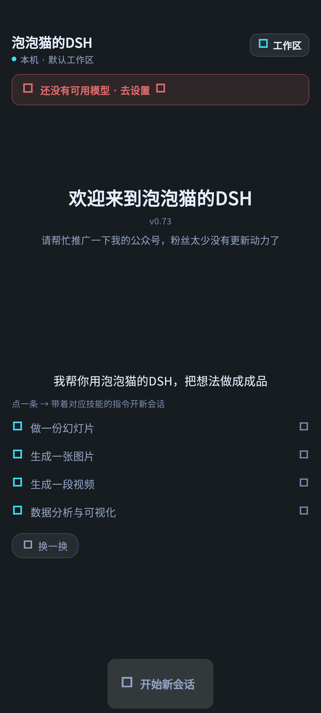

顶部工作区入口 + 起始语卡片 + 「换一换」；没有会话时按声明顺序显示前 4 条。

## 2. 工作台入口页（Tab 2）
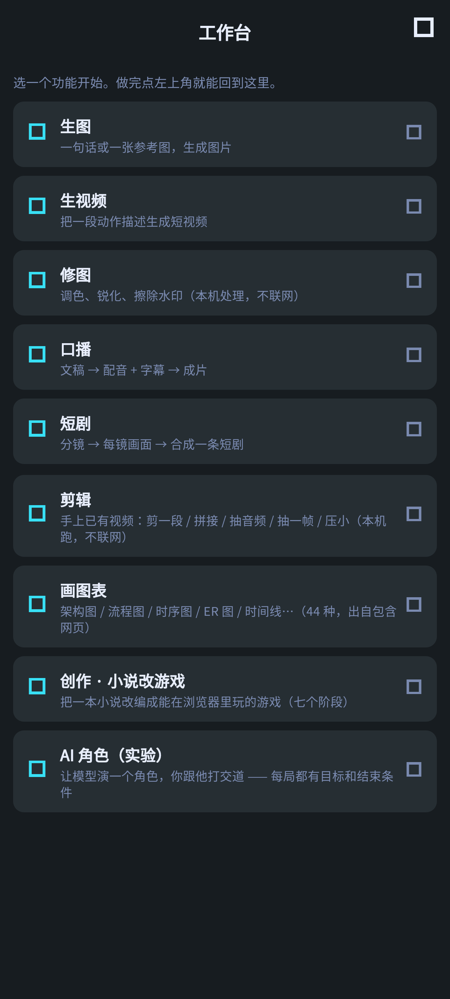

9 个入口：生图 / 生视频 / 修图 / 口播 / 短剧 / 剪辑 / 画图表 / 创作·小说改游戏 / AI 角色。
**注意这里没有「作品」** —— 0.72 起它挪到了「资料库」右上角。

## 3. 资料库（Tab 3）
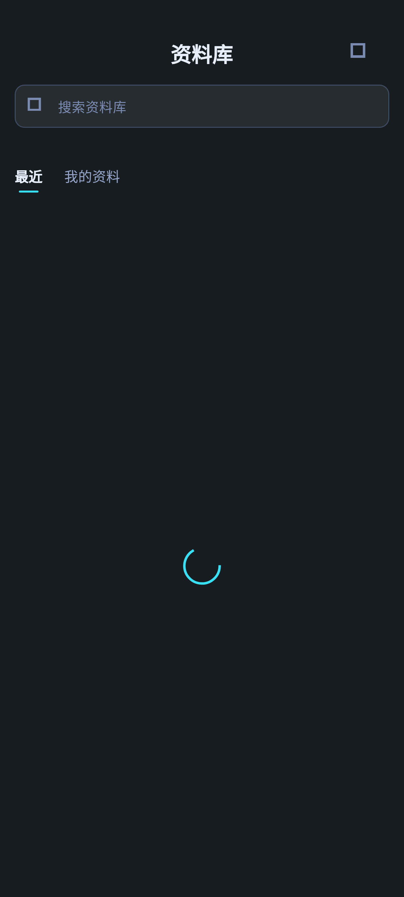

右上角：**作品入口**（九宫格图标）+ 「重新扫描」。测试环境工作区为空 → 空态。

## 4. 定时任务（Tab 4）
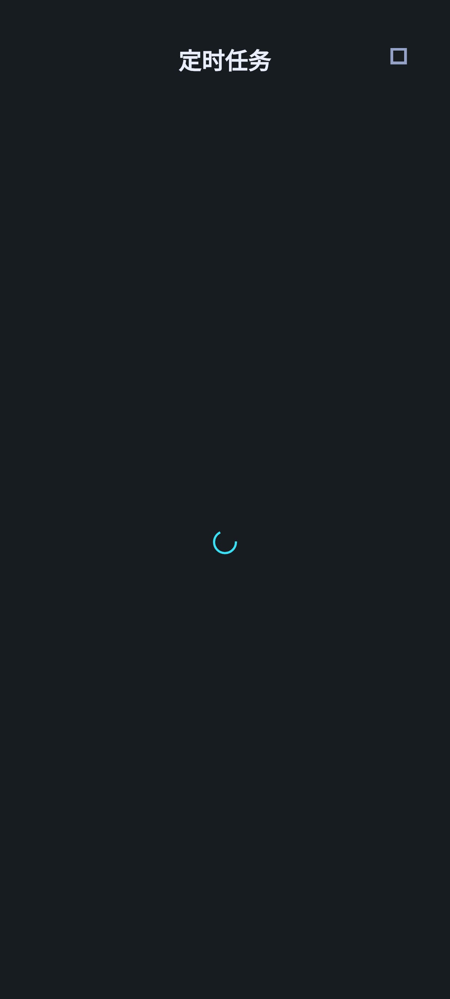

空态（测试环境没有任务）。

## 5. 工作台 · 生图
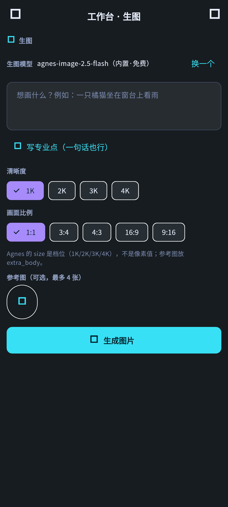

提示词 / 清晰度 / 比例 / 参考图 + 生成按钮。

## 6. 工作台 · 生视频
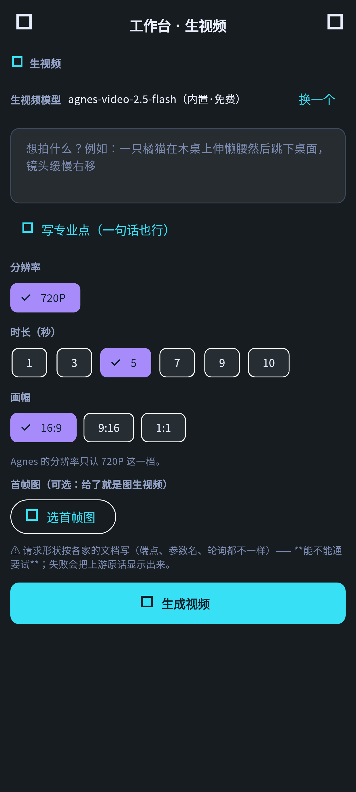

提示词 / 时长 / 画幅 + 首帧图（给了就是图生视频）。

## 7. 工作台 · 修图
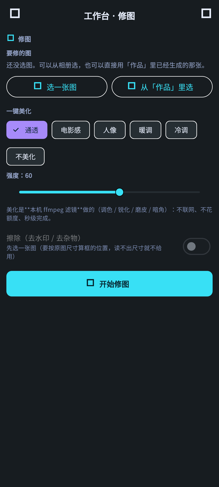

一键美化六档 + 强度滑杆（本机处理、不联网、不花额度）。

## 8. 工作台 · 口播（默认系统配音）
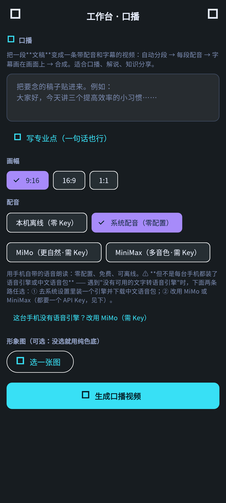

文稿 / 画幅 / **配音四档** / 形象图。

## 9. 工作台 · 口播 → 切到「本机离线」（0.73 新功能）
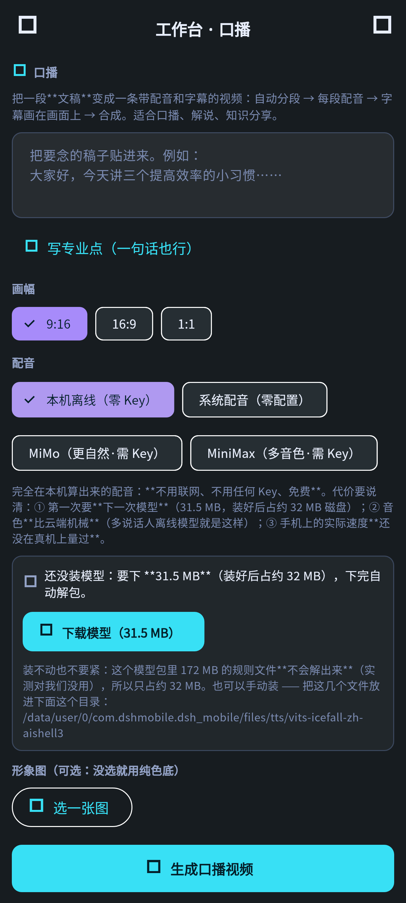

模型未装时的状态卡 + 「下载模型（31.5 MB）」+ **手动放置的目录** + 三条如实代价
（要下一次模型 / 音色比云端机械 / 手机速度未实测）。

## 10. 工作台 · 短剧
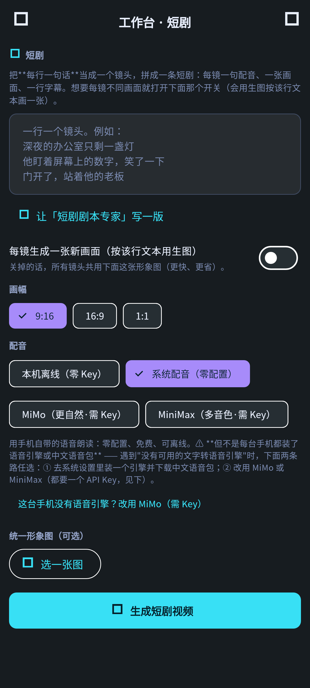

分镜（一行一镜）/ 每镜生成开关 / 配音。

## 11. 工作台 · 作品库
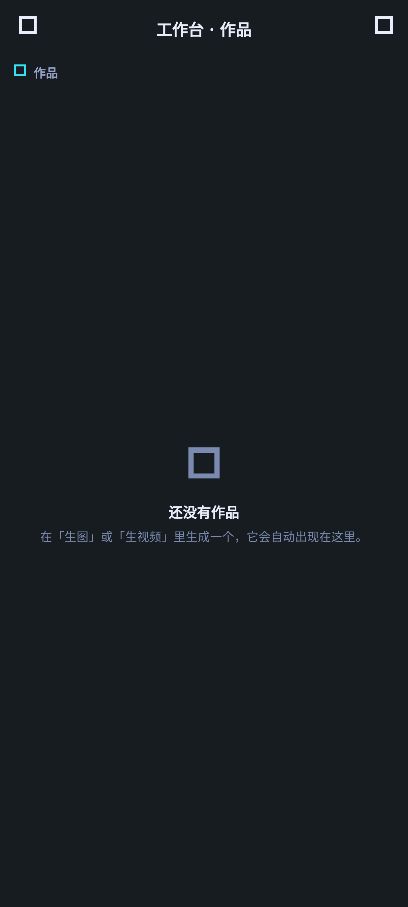

九宫格（测试环境无作品 → 空态）。这个入口现在挂在「资料库」右上角。

## 12. 工作台 · 剪辑
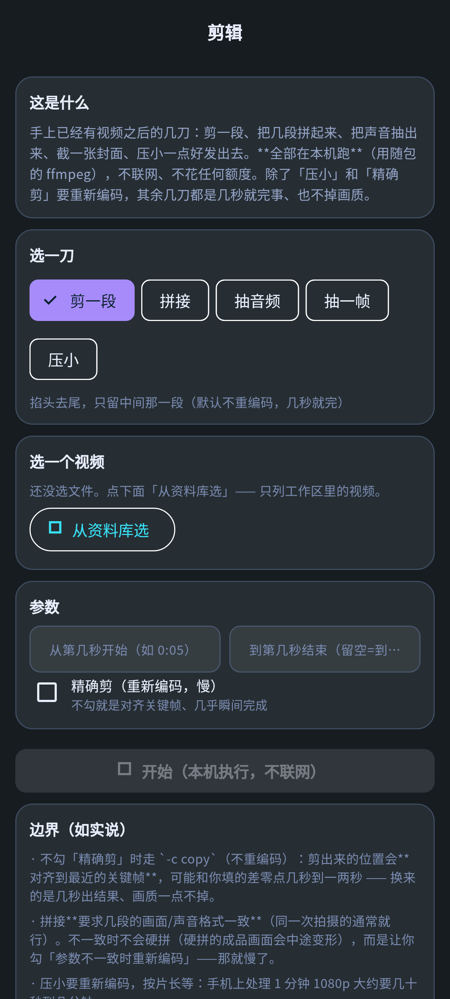

剪一段 / 拼接 / 抽音频 / 抽一帧 / 压小 + 「从资料库选」。

## 13. 工作台 · 画图表（弹层）
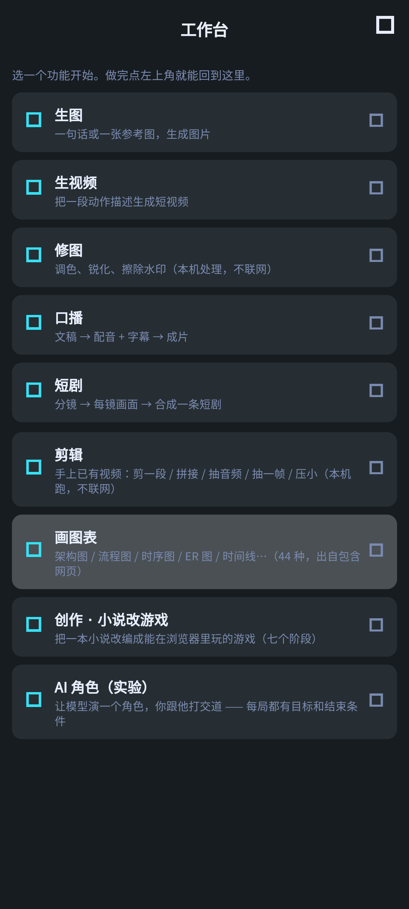

44 种图型说明 + 示例列表 + 如实边界（上游 python 自检脚本与 211 个示例没随包）。

## 14. 工作台 · 创作·小说改游戏
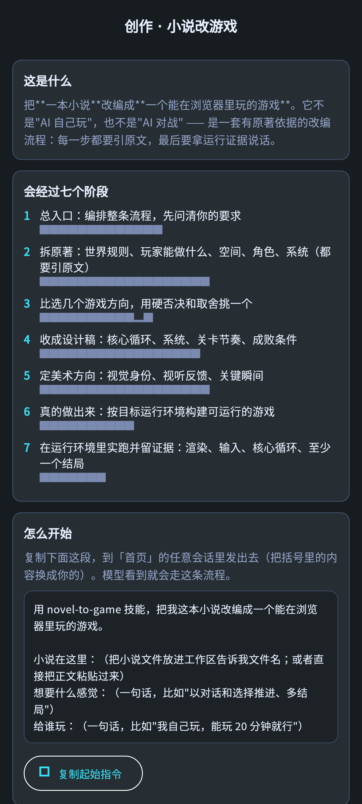

七阶段说明 + 「开始一个改编会话」+ 可复制的起始指令。

## 15. 工作台 · AI 角色（实验）
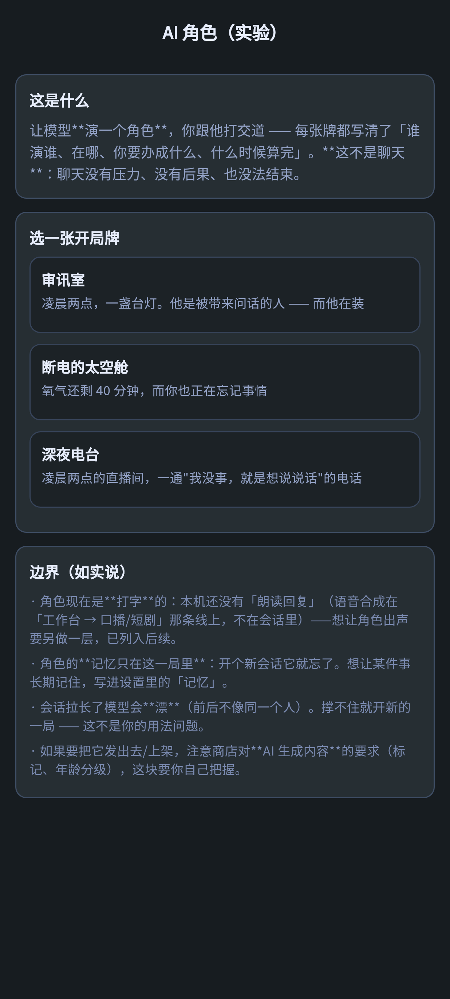

三张开局牌（审讯室 / 断电的太空舱 / 深夜电台）+「开始这一局」。

## 16. 会话页
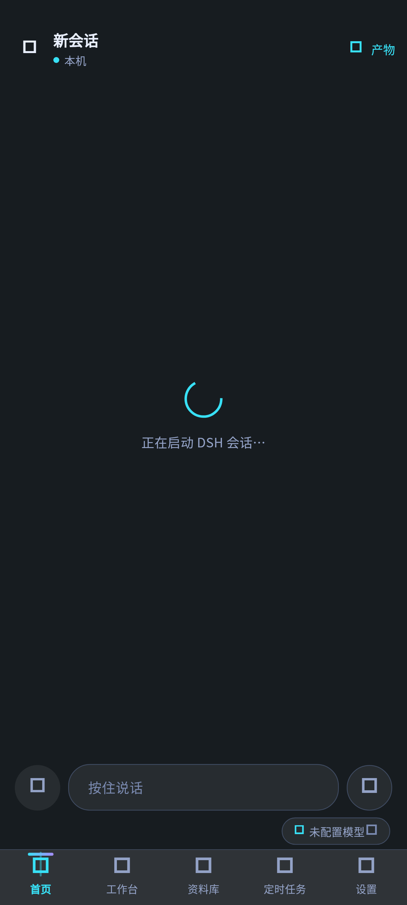

输入区 / 附件 / 模型面板（未开会话 → 初始态）。

## 17. 专家页
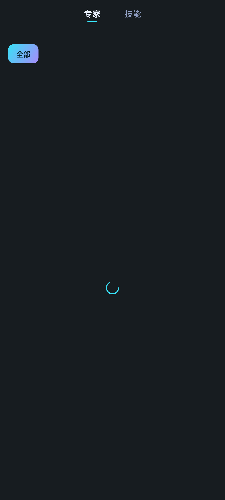

开关列表 + 技能栏（专家库为空）。

## 18. 记忆页
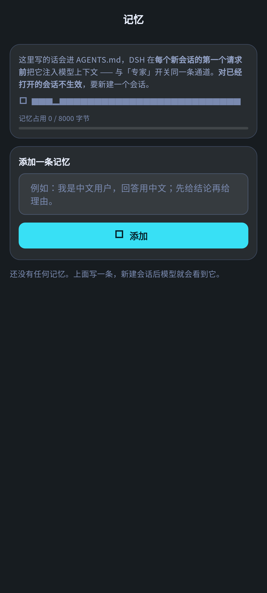

AGENTS.md 记忆的增删改界面。

## 19. 更新说明
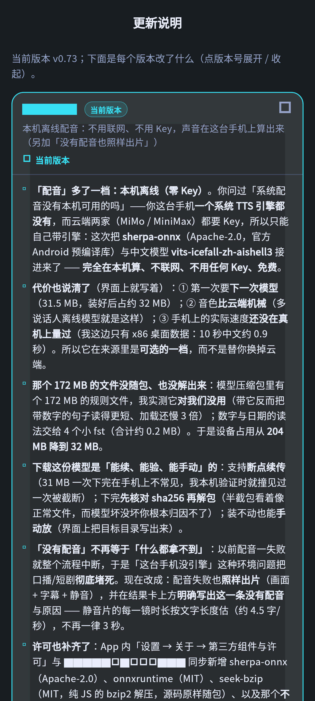

版本列表（含 0.73「本机离线配音」那条）。

## 20. 工作区管理页
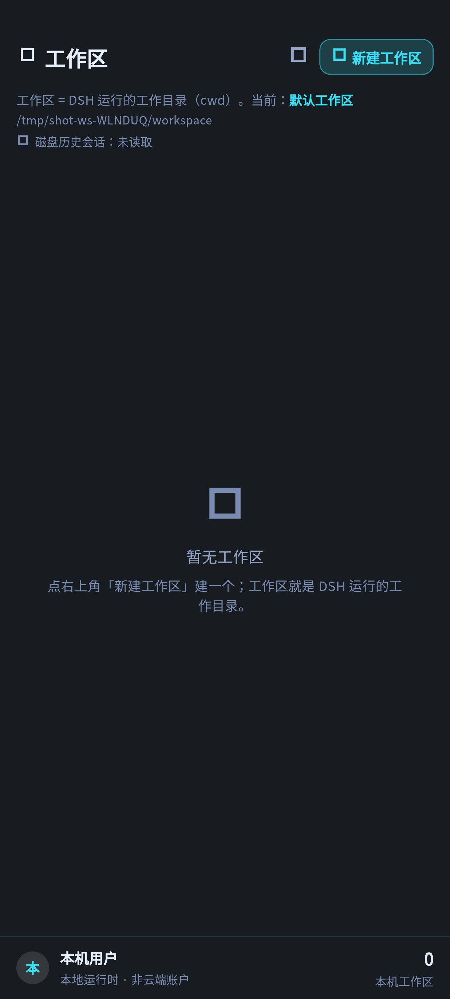

工作区列表 + 新建 / 刷新。

---

## 字体门（这次体检踩出来的）

`app/test/shot_font_gate_test.dart` 断言**截图里每一段文字都有字体族** ——
没有字体族就会渲染成方块（测试环境默认字体是 Ahem）。我最初只给 `textTheme` 盖了字体族，
结果 AppBar 标题、**芯片标签**、输入框提示全是方块，而 `flutter test` **一声不响**
（图照样出、测试照样绿）。现在这条门禁会红着告诉你哪几段文字会变方块 ——
负向自检过（去掉 `typography` 那层 → 立刻点名那 10 段）。

## 复现

```bash
# 逐张采集（每张起一个 flutter test，出图即收工）
cd /tmp/dsh-app && bash /tmp/all_shots.sh    # 产物在 /tmp/dsh-shots/
# 字体门
cd /tmp/dsh-app && flutter test --no-pub test/shot_font_gate_test.dart
```
